# NGINX no OpenShift — deploy, PVC e HPA

Exemplo simples para o trabalho de Cloud Builders: NGINX serve uma página HTML gravada em um volume persistente por um initContainer. Não é necessário construir uma imagem nem instalar Docker.

## Arquivos

| Arquivo | Objetivo |
| --- | --- |
| `1-pvc.yaml` | Solicitar 1 GiB de storage (bônus 2) |
| `2-deployment.yaml` | Executar NGINX e inicializar a página no PVC |
| `3-expose.yaml` | Service e Route HTTPS para acessar a página |
| `4-hpa.yaml` | Escalar de 2 a 4 réplicas por CPU (bônus 1) |
| [docs/relatorio.md](docs/relatorio.md) | Relatório separado com prints e resultados |

## Pré-requisitos

Cluster OpenShift, CLI `oc`, acesso a um projeto, download de imagens do Docker Hub e uma StorageClass padrão com provisionamento dinâmico. Para HPA, o cluster precisa fornecer métricas em `metrics.k8s.io`. A SCC padrão deve permitir o volume e atribuir o grupo de acesso ao PVC; não fixamos UID nem fsGroup, pois os intervalos permitidos variam por projeto.

## Passo 1 — projeto e PVC

Execute na raiz do repositório:

```bash
oc login https://API-DO-SEU-CLUSTER:6443
oc new-project trabalho-cloudbuilders
# Se já tem um projeto, use: oc project NOME-DO-PROJETO
oc apply -f 1-pvc.yaml
oc get pvc web-pvc
```

**Print:** criação do PVC. Ele pode ficar `Pending` até criar o Deployment se a StorageClass usar `WaitForFirstConsumer`. Após o deploy, registre o status `Bound` e o nome do PV:

```bash
oc get pvc web-pvc -o custom-columns=NAME:.metadata.name,STATUS:.status.phase,PV:.spec.volumeName
```

O PVC solicita armazenamento; o provisionador do cluster cria o PersistentVolume. Não é necessário um `pv.yaml` estático.

**Evidência da execução:** o manifesto foi aplicado e o PVC `web-pvc` ficou `Bound`, com capacidade de 1 GiB e StorageClass `nfs-storage`.

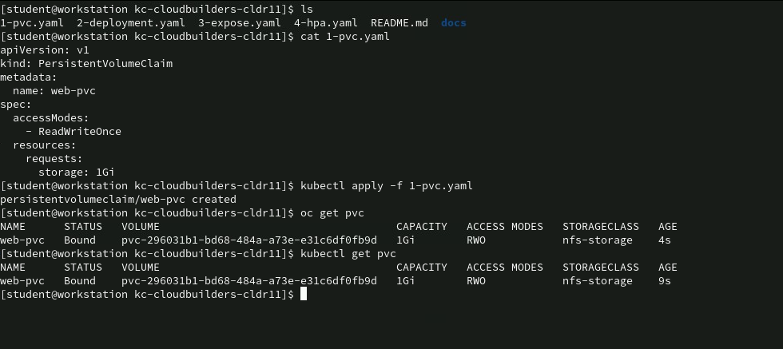

## Passo 2 — Deployment

```bash
oc apply -f 2-deployment.yaml
oc rollout status deployment/web-app --timeout=180s
oc get pods -l app=web-app -o wide
```

**Evidências da execução:** a aplicação do manifesto criou o Deployment `web-app`. O pod passou de `0/1` para `1/1 Ready`, em estado `Running`, e os logs do NGINX registraram respostas HTTP 200 às probes.

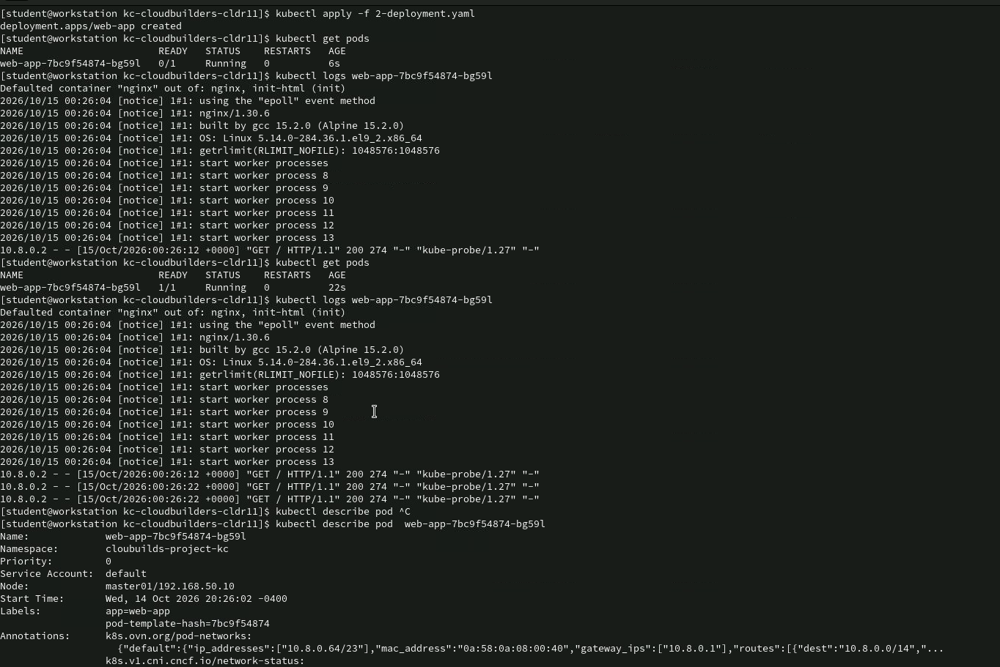

A inspeção do pod confirma os requests/limits, as probes e a montagem de `web-storage` em `/usr/share/nginx/html`, referenciando o PVC `web-pvc`. Os eventos mostram a execução do initContainer e do NGINX.

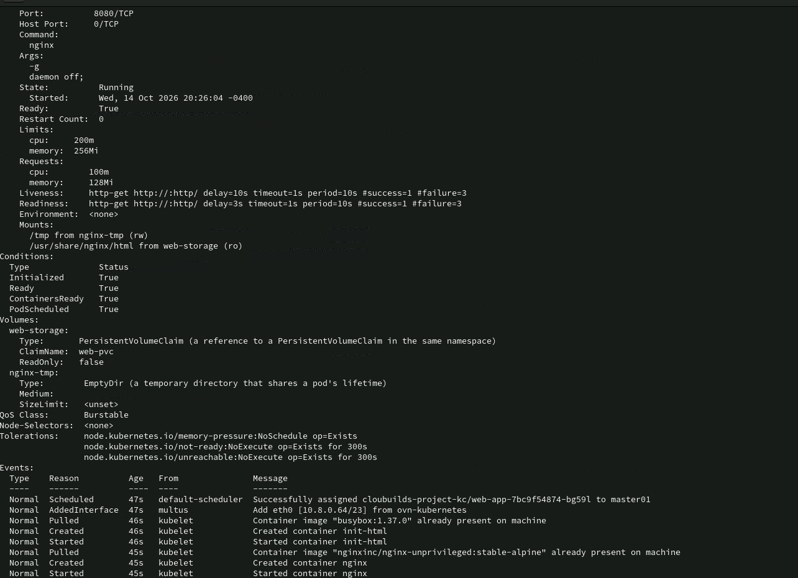

Usamos `nginxinc/nginx-unprivileged:stable-alpine`, preparado para execução sem root na porta 8080. O initContainer cria `index.html` somente se ele não existir, preservando alterações após reiniciar pods. NGINX monta o PVC apenas para leitura; `/tmp` é um volume temporário para PID e arquivos internos. A tag `stable-alpine` acompanha atualizações; para reprodução exata, fixe o digest da imagem utilizada na execução.

O PVC é `ReadWriteOnce`: pode ser usado por vários pods no **mesmo nó**, não por vários nós simultaneamente. A afinidade obrigatória mantém as réplicas juntas para evitar conflito de montagem ao escalar. Se esse nó não tiver recursos, réplicas podem ficar `Pending`. Este exemplo demonstra HPA, mas não oferece distribuição entre nós; para isso é necessário storage com `ReadWriteMany` e remover a afinidade.

## Passo 3 — Service e Route

```bash
oc apply -f 3-expose.yaml
oc get svc web-service
oc get route web-route
oc get route web-route -o jsonpath='https://{.spec.host}{"\n"}'
```

Abra a URL gerada. O Service recebe na porta 80 e encaminha para a porta 8080 dos pods; a Route oferece HTTPS com terminação TLS edge.

**Evidências da execução:** a aplicação de `3-expose.yaml` criou o Service e a Route. A consulta mostra a URL, o Service de destino e a terminação `edge/Redirect`.

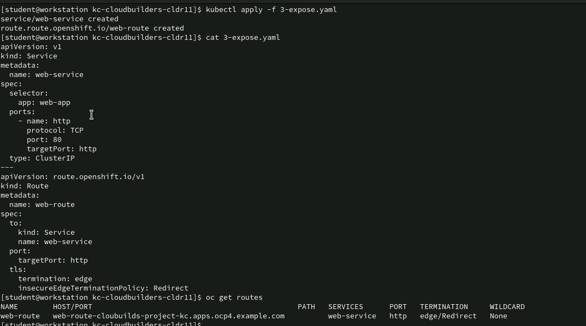

O acesso por HTTPS exibiu a página “Trabalho FIAP - Cloud Builders”.

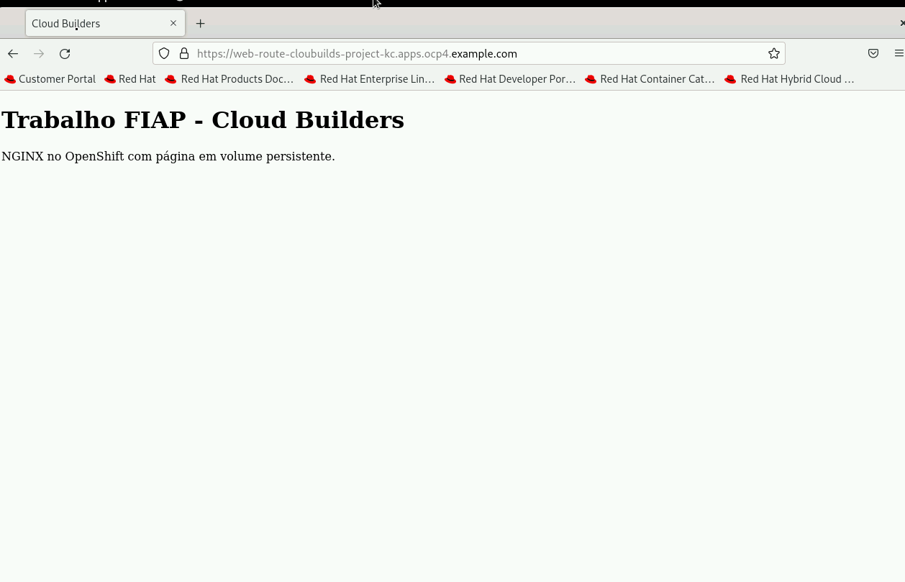

## Passo 4 — HPA

```bash
oc apply -f 4-hpa.yaml
oc get hpa web-hpa
oc describe hpa web-hpa
oc adm top pods
```

**Evidências da execução:** o HPA foi criado inicialmente com mínimo de 1 e máximo de 4 réplicas. As primeiras consultas exibiram `<unknown>` enquanto as métricas ainda não estavam disponíveis. Em seguida, o mínimo foi alterado para 2.

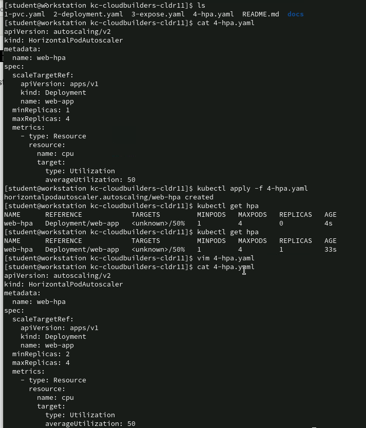

Após reaplicar o manifesto com `minReplicas: 2`, a consulta passou a mostrar métricas de CPU e a listagem confirmou dois pods `Running, 1/1 Ready`. O YAML entregue contém essa configuração final.

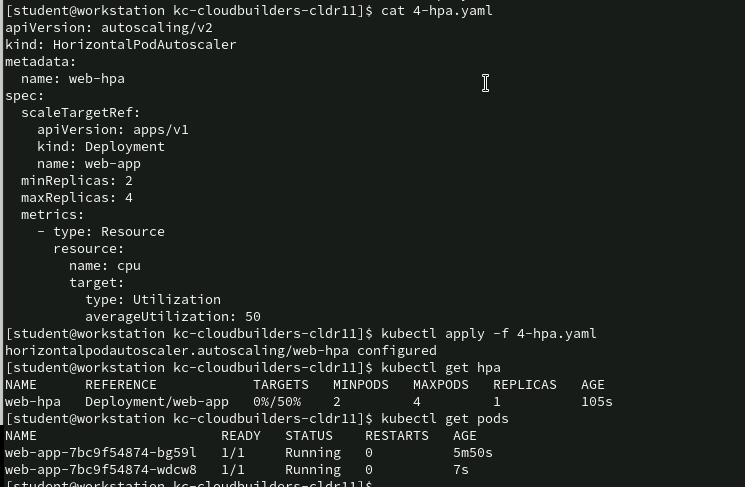

O HPA usa **50% do request de CPU**, e não do limit: com request de 100m, o alvo é uma média de 50m por pod. O request de CPU e as métricas são necessários para esse cálculo; limits delimitam recursos, mas não são a base da porcentagem. Usamos Deployment (`apps/v1`), cujo nome está em `scaleTargetRef`.

### Evidências dos recursos no console do OpenShift

O console do projeto `cloubuilds-project-kc` mostra o Deployment `web-app` com dois pods em execução, o HPA `web-hpa`, o Service `web-service` e a Route `web-route`.

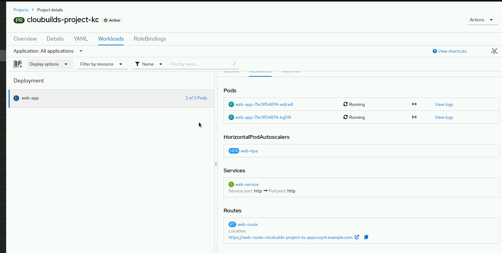

A tela do PVC confirma `web-pvc` em estado `Bound`, capacidade solicitada e vinculada de 1 GiB e modo de acesso `ReadWriteOnce`.

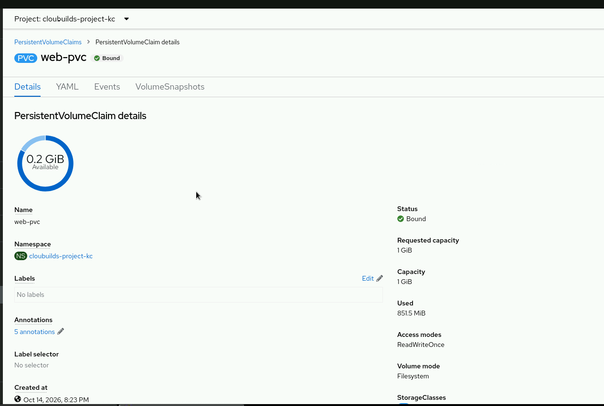

### Carga opcional

Em um terminal, gere tráfego para o Service:

```bash
oc run load-generator --image=busybox:1.37.0 --restart=Never -- /bin/sh -c 'for i in 1 2 3 4 5 6 7 8; do (while true; do wget -q -O /dev/null http://web-service/ || sleep 1; done) & done; sleep 180; kill $(jobs -p); wait'
```

Em outro terminal, acompanhe:

```bash
oc get hpa,pods -w
# Após aproximadamente 3 minutos, Ctrl+C encerra a observação.
oc delete pod load-generator
```

NGINX servindo uma página pequena pode consumir pouca CPU: tráfego não garante atingir o alvo nem criar mais réplicas. Registre o resultado real. A configuração do HPA já pode ser evidenciada sem afirmar que houve expansão. Se o pod de carga continuar ativo, sua exclusão interrompe a carga.

**Resultado observado no teste:** com o `load-generator` ativo, o HPA mostrou inicialmente `50%/50%` e duas réplicas. A CPU chegou a `73%/50%`, surgiu um terceiro pod e, na consulta seguinte, o HPA registrou três réplicas com os pods `1/1 Ready`.

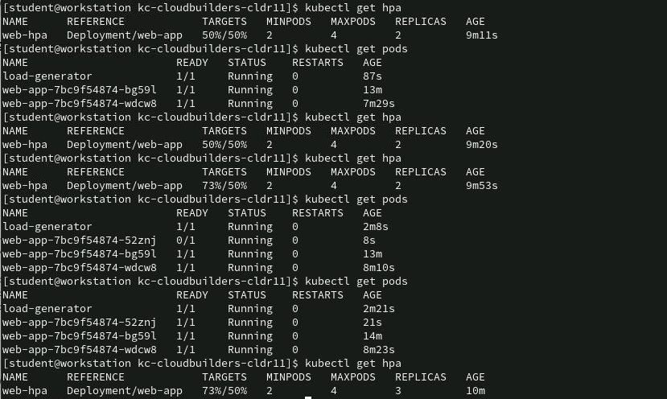

Os gráficos do Deployment no console registram o aumento do uso de CPU e do tráfego de entrada durante o teste, além das métricas de memória e filesystem. A confirmação da expansão está na listagem de pods e do HPA acima.

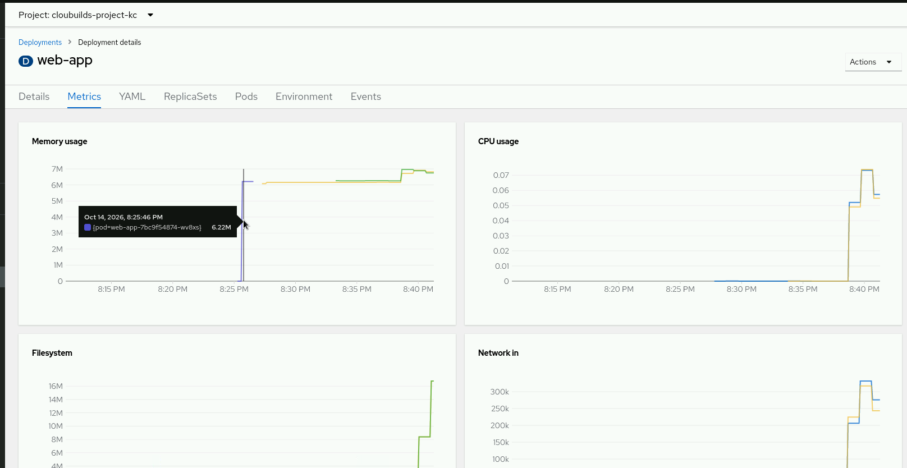

## Testar persistência

O initContainer grava uma marca com data e nome do pod original em um comentário HTML, somente quando cria o arquivo. Compare essa marca antes e depois da recriação:

```bash
oc exec deployment/web-app -- cat /usr/share/nginx/html/index.html
oc get pods -l app=web-app
oc delete pod -l app=web-app
oc rollout status deployment/web-app --timeout=180s
oc get pods -l app=web-app
oc exec deployment/web-app -- cat /usr/share/nginx/html/index.html
```

Execute preferencialmente antes do HPA, com uma réplica. O pod deve mudar e o comentário deve manter a data e o nome do pod original. Isso demonstra que o arquivo foi preservado no PVC, em vez de recriado pelo initContainer. **Print:** conteúdo antes/depois, nomes dos pods e PVC `Bound`.

**Evidência da execução:** após excluir o gerador de carga, lemos o HTML, excluímos os pods da aplicação e aguardamos a recriação. Os novos pods ficaram `Running, 1/1 Ready`. A segunda leitura preservou o conteúdo e a marca original `2026-10-15T00:24:39Z`, com o nome do pod que inicializou o volume, comprovando a persistência. Neste teste, o HPA já estava ativo e foram recriados os três pods da aplicação.

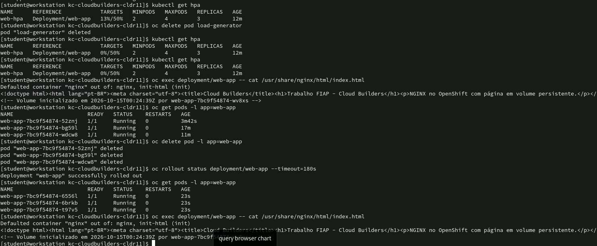

## Diagnóstico

- PVC `Pending`: consulte `oc describe pvc web-pvc`. Se não houver StorageClass padrão, informe `storageClassName: NOME-DA-CLASSE` no spec do PVC antes de criá-lo. Confirme provisionamento com o administrador.
- HPA `<unknown>`: consulte `oc describe hpa web-hpa` e `oc adm top pods`; as métricas podem levar alguns minutos. Confirme que o cluster oferece métricas de CPU.
- Pods `Pending`: consulte `oc describe pod NOME`. As réplicas precisam caber no mesmo nó por causa do PVC ReadWriteOnce.
- Falhas de inicialização: consulte `oc logs NOME -c init-html` e `oc logs NOME -c nginx`, além de `oc describe pod NOME`, para verificar permissões, montagem, imagem e quotas.

## Referências

- [NGINX sem root](https://github.com/nginx/docker-nginx-unprivileged).
- [Kubernetes: Persistent Volumes e modos de acesso](https://kubernetes.io/docs/concepts/storage/persistent-volumes/).
- [Kubernetes: HPA e requests de CPU](https://kubernetes.io/docs/concepts/workloads/autoscaling/horizontal-pod-autoscale/).
